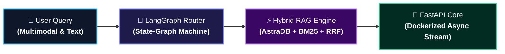

 

 

  
  &nbsp;
  
  &nbsp;
  

---

### ⚡ Systems Engineering Philosophy

I engineer production-grade AI systems that bridge raw non-deterministic foundation models with deterministic software architecture. My core work focuses on **LangGraph state machines**, **hybrid dense/sparse retrieval engines**, and **containerized FastAPI backends** optimized for latency (p50/p95), token costs, and strict schema validation.

Actively open to **AI/ML & Generative AI Engineering opportunities** building scalable agentic systems.

---

### 🏛️ Flagship Production Architectures

<table>
  <thead>
    <tr>
      <th width="35%">System &amp; Focus</th>
      <th width="45%">Architecture &amp; Engineering Solution</th>
      <th width="20%">Deployments</th>
    </tr>
  </thead>
  <tbody>
    <tr>
      <td>
        <b>🛍️ Flipkart AI Shopping Assistant</b> 
        Multi-Agent Supervisor &amp; Hybrid RAG  
        
        
        
      </td>
      <td>
        • Architected a <b>multi-agent LangGraph supervisor</b> routing queries across 3 specialized sub-agents over 6 catalog domains. 
        • Implemented <b>Reciprocal Rank Fusion (RRF)</b> uniting AstraDB dense embeddings with BM25 lexical search, reranked via cross-encoders to top-4. 
        • Containerized FastAPI backend with token usage instrumentation and GitHub Actions CI/CD.
      </td>
      <td align="center">
          
        
      </td>
    </tr>
    <tr>
      <td>
        <b>✈️ FairFare Flight Agent</b> 
        ReAct Flight Agent &amp; ML Pricing Engine  
        
        
        
      </td>
      <td>
        • Autonomous <b>ReAct LangGraph agent</b> navigating live flight inventories and executing programmatic booking rule validations. 
        • Trained predictive pricing model over <b>300K+ historical flight logs</b> (98.4% R², MAE ₹1,368) backed by real-time SHAP feature attribution. 
        • Verified with automated Playwright end-to-end evaluation harness on Render cloud.
      </td>
      <td align="center">
          
        
      </td>
    </tr>
    <tr>
      <td>
        <b>🥗 MacroChat AI</b> 
        Multimodal Vision &amp; Zero-Hallucination RAG  
        
        
        
      </td>
      <td>
        • Solved LLM nutritional inaccuracy by using <b>GPT-4o Vision purely for ingredient identification</b>, while resolving calories and macros deterministically via database lookups (1,014 Indian recipes + USDA). 
        • Implemented dynamic BMR/TDEE calculation (Mifflin-St Jeor formula) inside PostgreSQL stored queries with Row Level Security (RLS).
      </td>
      <td align="center">
          
        
      </td>
    </tr>
    <tr>
      <td>
        <b>🎙️ JARVIS Voice &amp; Task Agent</b> 
        Multi-Agent State Governance &amp; Long-Term Memory  
        
        
        
      </td>
      <td>
        • Modular conversational agent with multi-modal voice processing, asynchronous task execution, and SQLite checkpoint state memory. 
        • Integrated tool calling for system operations, calendar scheduling, and automated information retrieval with Docker Compose deployment.
      </td>
      <td align="center">
        
      </td>
    </tr>
  </tbody>
</table>

---

### 🛠️ Production Technology Stack

#### 🧠 Agentic AI, LLMOps & Retrieval

  
  
  
  
  
  
  
  
  

#### ⚡ Backend Microservices, Cloud & Databases

  
  
  
  
  
  
  
  

#### 🔬 Core Machine Learning & Data Science

  
  
  
  
  

---

  

    <b>📍 Mumbai, Maharashtra, India</b> &nbsp;•&nbsp; 
    <a href="https://portfolio-liard-mu-5zv1yuvq8q.vercel.app/">portfolio-liard-mu-5zv1yuvq8q.vercel.app</a> &nbsp;•&nbsp; 
    <a href="mailto:mimali31394@gmail.com">mimali31394@gmail.com</a>
  

  

    <i>"Designing deterministic, agentic AI pipelines that bridge raw foundation models with enterprise execution."</i>
  

